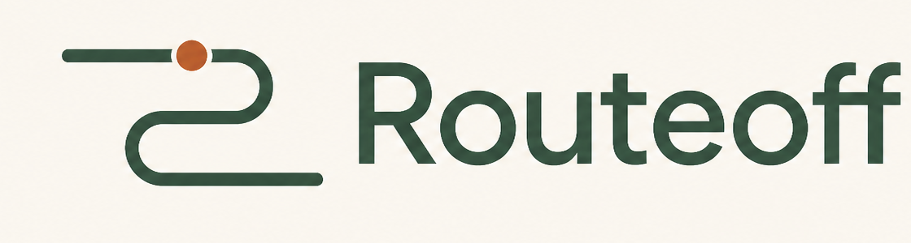

# Routeoff



いつもの道から少し外れ、日常の発見を一枚持ち帰るAIアプリです。

その日にほしい気分から小さな寄り道を提案し、写真と本人が確かめた言葉を、次の行動につなげます。

[AI HACK 2026](https://aihackathon.jp/)で、teamRが約1週間で企画、実装、検証したプロダクトです。

- [3分デモ動画（YouTube）](https://youtu.be/OsqdQ6R76FE)
- [開発背景と実装内容（Qiita）](https://qiita.com/araidon/items/466dd1b6d5421e7ae5fe)

## Routeoffの体験

1. 「気持ちを整えたい」「小さく冒険したい」など、今日ほしい気分を選びます。
2. AIから、5〜15分で試せる小さな寄り道を受け取ります。
3. 寄り道で見つけたものを一枚だけ写真に残します。
4. AIが示した観察候補を、本人が採用、修正、非表示から選びます。
5. My Routeで直近7日間を振り返り、根拠となる記録から理由付きの次の寄り道へ進みます。

「みつける」では、その日に選んだ気分と同じ気分、近い気分、その他の順に景色を表示します。

いいね数やランキングは置かず、写真をきっかけに別の寄り道をのぞく体験にしています。

## AIの役割

固定のお題を返すだけでなく、本人が確かめた過去の記録を次の行動へつなぐためにAIを利用しています。

- 気分、最近の記録、保存済みの任意プロフィールから、今日の寄り道を提案する
- 写真から直接観察できる色、光、形などを、本人が確認するための候補として示す
- 本人が残すと決めた根拠から、週次の3行と次の寄り道を組み立てる

AIの解釈をそのまま本人の記録にはしません。

週次の結果では、AIが返した根拠IDを保存済みの記録と照合し、対応する根拠がない結果を採用しない設計です。

## 現在の実装範囲

このリポジトリは、ローカルPCで動かすハッカソン用デモです。

| 項目 | 現在の実装 |
|---|---|
| 画面 | HTML、CSS、JavaScript |
| ローカルAPI | Node.js |
| 記録の保存 | ブラウザのIndexedDB |
| AI接続 | ローカルAPIから[OrcaRouter](https://www.orcarouter.ai/ja)を呼び出す |
| AI未設定・通信失敗時 | 固定文へ切り替えて体験を継続する |
| 「みつける」 | ローカルのデモ投稿を表示する |

認証、クラウド同期、実ユーザー投稿の公開、別PC間のデータ共有は実装していません。

## 起動方法

### 必要なもの

- Node.js 20以上
- AIによる個別提案を試す場合のみ、OrcaRouter APIキー

### 1. リポジトリを取得する

```bash
git clone https://github.com/ryonpiiman3150-lab/AI-Hackathon.git
cd AI-Hackathon
```

### 2. アプリを起動する

```bash
npm start
```

既定のブラウザで `http://127.0.0.1:8000/` が開きます。

終了する場合は、起動したターミナルで `Ctrl + C` を押します。

macOSでは `start.command`、Windowsでは `start.bat` からも起動できます。

## OrcaRouterを利用する

APIキーがなくても、固定文を使って主要な画面と体験を確認できます。

AIによる寄り道提案と写真の振り返りを試す場合は、プロジェクトのルートで `.env.local` を作成します。

Mac、Linux：

```bash
cp .env.example .env.local
```

Windows PowerShell：

```powershell
Copy-Item .env.example .env.local
```

`.env.local` に、自分で発行したAPIキーを設定します。

```dotenv
ORCAROUTER_API_KEY=your-api-key
ORCAROUTER_BASE_URL=https://api.orcarouter.ai/v1
```

設定後にアプリを再起動してください。

`http://127.0.0.1:8000/api/health` で `"configured": true` を確認できます。

APIキーはブラウザへ渡さず、ローカルの `server.js` だけが読み込みます。

`.env.local` はGitの管理対象外です。

## データと外部AI通信

- 写真、下書き、記録、任意プロフィールは、起動したブラウザ内に保存します。
- 今日の寄り道では、気分、最近の記録、保存済みの任意プロフィールを外部AIへ送ります。
- 写真の振り返りでは、上記に加えて、ブラウザで縮小・再圧縮した画像を送ります。
- 週次振り返りでは、本人が承認または修正した根拠と本人の言葉を送ります。
- AI処理レシートには、用途、送信量、トークン数、応答時間、コストを記録し、画像、プロンプト、応答本文は保存しません。

画面には、外部AIへ送る対象、処理状態、成功、固定文への切り替えを表示します。

## テスト

```bash
npm test
```

週次振り返りの出力検証、利用者向け文言、My Routeへの表記統一を確認します。

## 現在の対象外

- 本番用の認証とクラウド保存
- 実ユーザー投稿の公開と端末間同期
- いいね数、フォロワー数、ランキング、連続記録などの競争・継続指標
- 通知、位置情報、天候との連携
- 外部SNSへの直接投稿と反応数の取得

本番化では、利用者が明示的に選んだ記録だけを公開対象とし、モバイルアプリとクラウド基盤へ移行する構想です。

## 関連リンク

- [Routeoffデモ動画](https://youtu.be/OsqdQ6R76FE)
- [Qiita：過去の一枚から次の寄り道をつくるAIアプリ「Routeoff」](https://qiita.com/araidon/items/466dd1b6d5421e7ae5fe)
- [OrcaRouter公式サイト](https://www.orcarouter.ai/ja)
- [OrcaRouter Documentation](https://docs.orcarouter.ai/introduction)
